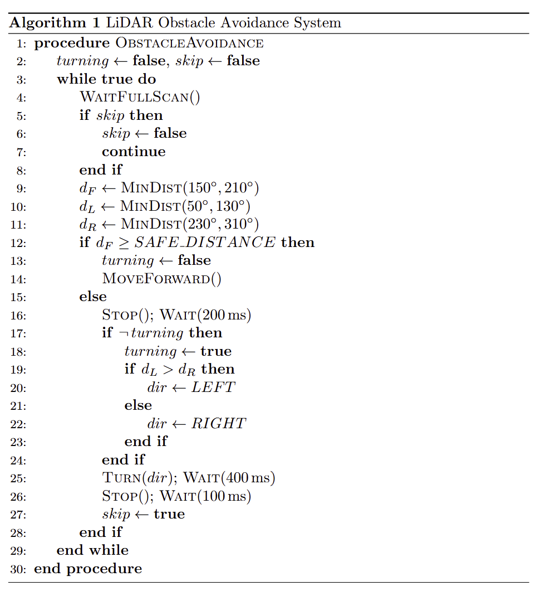

# LiDAR 기반 장애물 회피 구현 프로젝트

ESP32와 360° LiDAR로 전방 장애물을 감지하고 좌·우 중 더 트인 쪽으로 회전해 피해 가는 4륜 로봇을 구현하는 프로젝트이다.

## 1. 개요

- LiDAR가 한 바퀴(360°) 스캔을 마칠 때마다 전방·좌측·우측의 최소 거리를 계산한다.
- 전방이 `SAFE_DISTANCE`(300 mm)보다 가까우면 정지한 뒤 더 트인 쪽으로 짧게 제자리 회전한다.
- 전방이 트이면 전진한다.

## 2. 하드웨어 구성

| 구성 | 내용 |
|---|---|
| MCU | ESP32 |
| 센서 | 360° LiDAR (UART 230400 bps, 47바이트 패킷, 헤더 `0x54 0x2C`) |
| 구동 | DC 모터 4개 (전륜·후륜 좌우), 모터당 IN1/IN2 2핀 제어 |

### 핀 배치

| 모터 | IN1 | IN2 |
|---|---|---|
| Front Right (FR) | 26 | 25 |
| Front Left (FL) | 19 | 27 |
| Rear Right (RR) | 23 | 12 |
| Rear Left (RL) | 0 | 15 |

### 모터 동작

| 동작 | 오른쪽 바퀴 | 왼쪽 바퀴 |
|---|---|---|
| 전진 | 전진 | 전진 |
| 좌회전 (제자리) | 전진 | 후진 |
| 우회전 (제자리) | 후진 | 전진 |
| 정지 | 모든 핀 LOW | 모든 핀 LOW |

## 3. LiDAR 각도 기준

LiDAR가 뒤를 0°로 보도록 장착되어 있다.

| 방향 | 각도 | 판단 범위 |
|---|---|---|
| 후방 | 0° | — |
| 좌측 | 90° | 50° – 130° (±40°) |
| 전방 | 180° | 150° – 210° (±30°) |
| 우측 | 270° | 230° – 310° (±40°) |

## 4. 데이터 처리

1. `Serial2`에서 헤더 `0x54 0x2C`를 찾아 47바이트 패킷을 읽는다.
2. 패킷의 시작각·끝각(0.01° 단위)을 읽고 12개 측정점의 각도를 그 사이에서 균등하게 나눠 계산한다.
3. 각 측정점의 거리(mm)를 반올림한 정수 각도 칸 `distances[0..359]`에 저장한다. 거리가 0인 값(측정 실패)은 저장하지 않는다.
4. 각도가 300° 초과에서 60° 미만으로 넘어가면 한 바퀴가 끝난 것으로 보고 판단을 실행한다.
5. `MinDist(start, end)`는 범위 안에서 0을 제외한 최솟값을 반환한다. 유효값이 없으면 9999를 반환한다.

## 5. 알고리즘



### 동작 흐름 예시

```
스캔 → 트임 → 전진
스캔 → 막힘 → 정지 → 좌우 비교(왼쪽이 더 트임) → 좌회전 400ms → 정지 → skip
스캔 → (정지한 채 무시)
스캔 → 아직 막힘 → 정지 → 비교 없이 계속 좌회전 400ms → 정지 → skip
스캔 → (정지한 채 무시)
스캔 → 트임 → 전진, turning 초기화
```

## 6. 설계 포인트

### 한 바퀴 단위 판단 (`WaitFullScan`)
일부 각도만 보고 성급하게 판단하지 않도록 LiDAR가 360°를 한 바퀴 다 돈 뒤에만 판단한다.

### 회전 직후 스캔 무시 (`skip` / `skipNextScan`)
회전 직후의 한 바퀴에는 회전 전과 회전 중에 잰 거리가 섞여 있다. 이 데이터로 판단하면 틀리기 쉬워서 한 바퀴를 버린다. 회전 중 `delay()`로 놓친 패킷의 영향도 이 바퀴에 몰리므로 함께 걸러진다.

### 회전 방향 유지 (`turning` / `wasTurning`)
회전 방향은 **장애물을 처음 만났을 때만** 정하고 앞이 트일 때까지 바꾸지 않는다. 매번 좌우를 다시 비교하면 모서리처럼 좌우가 비슷한 곳에서 왼쪽, 오른쪽을 번갈아 돌며 제자리에서 흔들리는(진동) 문제가 생긴다.

### 최솟값 사용
범위 안의 최솟값으로 판단해서 가장 가까운 물체를 기준으로 보수적으로 회피한다.

## 7. 시연

시연 장소: 실내 타일 바닥

시연 영상: `LiDAR_Obstacle_Avoidance_Video.mp4` (약 21초)

시연 중 장애물과 충돌 없이 주행했다.

## 8. 구현 중 발견한 문제와 해결

### 회전 직후 낡은 데이터로 판단하는 문제

**문제**

회전을 마친 뒤 회전 전 데이터로 판단해서 이미 앞이 트였는데도 다시 회전했다. 그 결과 필요 이상으로 많이 회전하는 모습을 보였다.

**원인**

1. 회전하는 동안(약 0.7초)은 `delay()` 때문에 LiDAR 데이터를 읽지 못한다.
2. 시리얼 수신 버퍼(256바이트)가 금방 차고 그 뒤로 들어온 데이터는 버려진다.
3. 그래서 버퍼에는 회전을 시작하기 직전의 데이터만 남는다.
4. 회전이 끝나면 이 낡은 데이터부터 읽기 때문에 `distances[]`에 회전 전 방향과 회전 후 방향의 값이 섞인다.
5. 섞인 상태로 다음 판단이 실행된다.

**해결**

회전 후 첫 번째 한 바퀴는 판단하지 않고 넘기고 그다음 한 바퀴로 판단하도록 바꿨다.

```
회전 → 정지 → [섞인 한 바퀴: 버림] → [새로 측정한 한 바퀴: 판단]
```

따라서 회전할 때마다 약 0.1초를 더 기다리는 대신 판단이 정확해지게 되었다.
